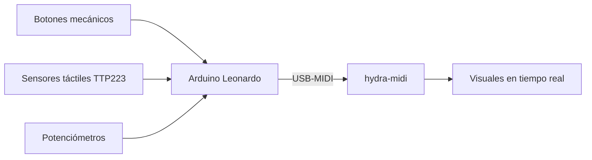
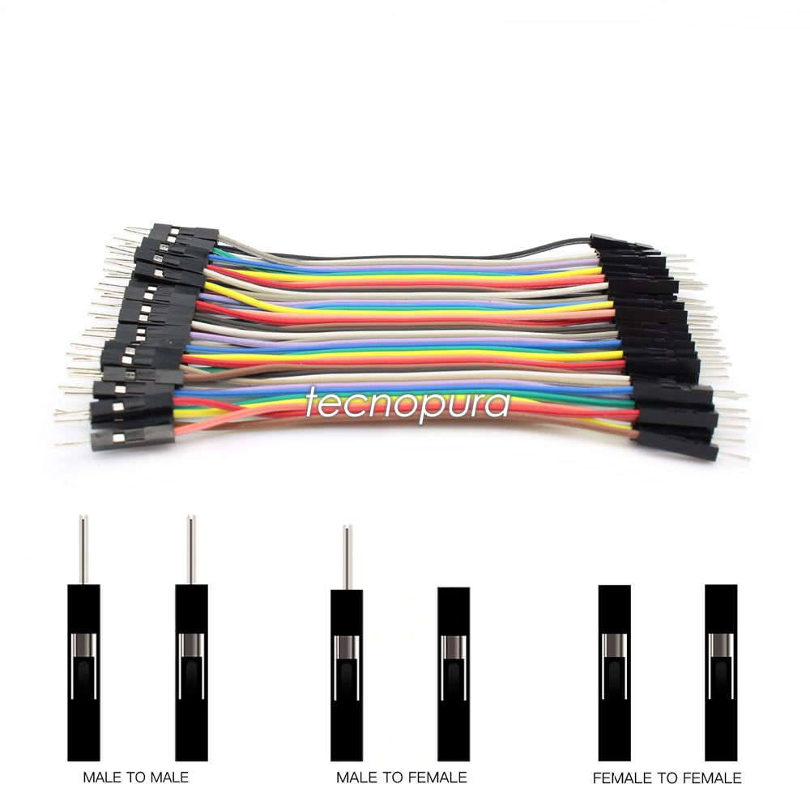
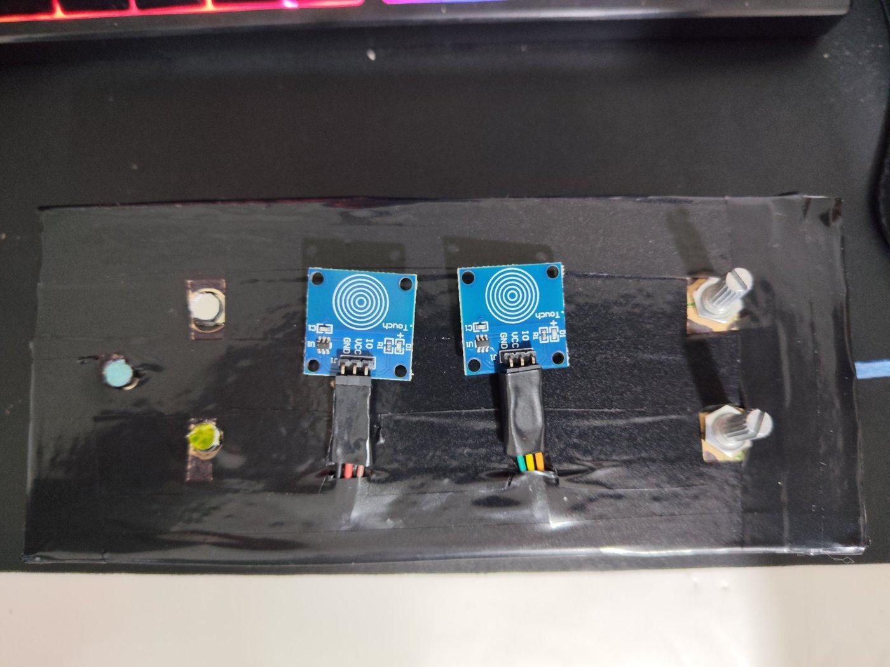
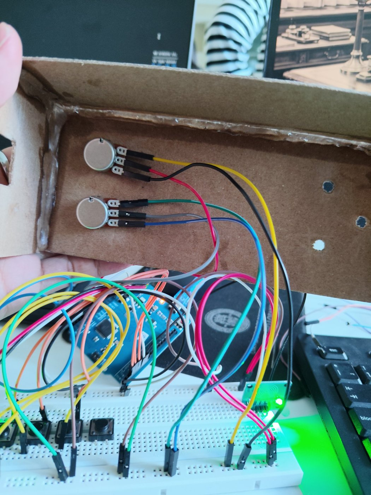
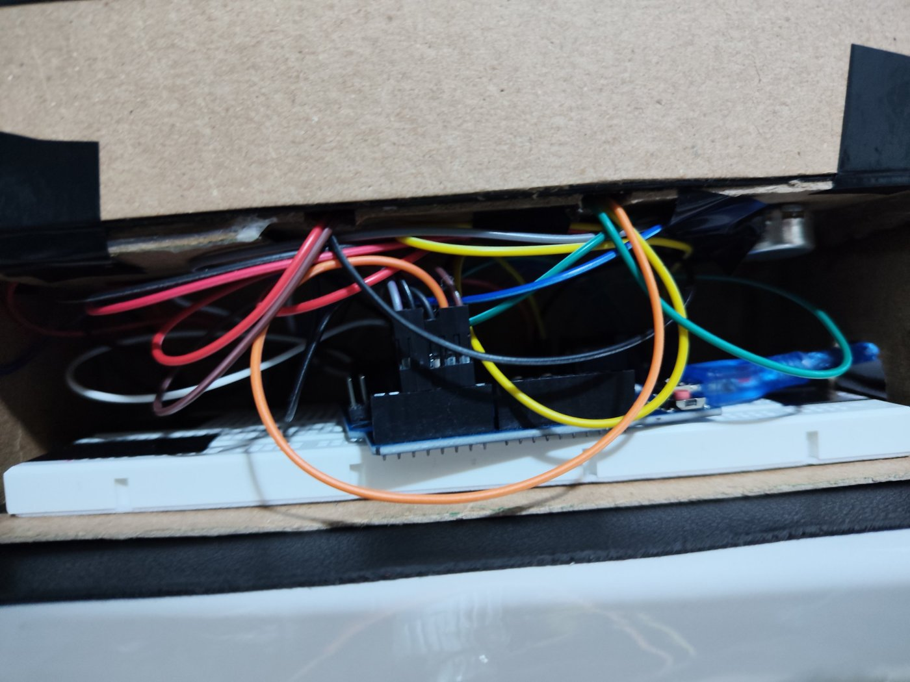

<div align="center">


# 🎛️ MIDI DJ - Controller and Visual Synthesizer Interface

### Controlador MIDI artesanal para tocar visuales en tiempo real


<a href="https://youtube.com/shorts/Oh7JFBQOh2Q">
  
</a>

<sub>▶ Clic en la imagen para ver la demo</sub>

</div>

---

> Controlador MIDI artesanal basado en **Arduino Leonardo (ATmega32u4)** con sensores táctiles capacitivos TTP223, botones mecánicos y potenciómetros analógicos, diseñado para la generación y control de visuales en tiempo real mediante **Hydra Synth**.

---

## ⚡ Características Principales

* **🔌 USB-MIDI Nativo (Plug & Play):** Gracias al microcontrolador ATmega32u4 y la librería oficial `MIDIUSB.h`, el dispositivo es reconocido de forma nativa por el sistema operativo sin requerir software puente adicional.
* **🖐️ Interfaz Híbrida (Táctil y Mecánica):** 
  * 3x Botones mecánicos configurados con resistencia Pull-up interna.
  * 2x Sensores táctiles capacitivos TTP223 para una respuesta de disparo instantánea.
* **🎛️ Control Analógico Continuo:** 2x Potenciómetros conectados a entradas analógicas para control de parámetros por Control Change (`CC 10` y `CC 11`).
* **🌐 Integración con Hydra Synth:** Uso directo de la librería oficial `hydra-midi` en la consola web para mapeo fluido de notas e impulsos de control.

---

## 🔁 Cómo funciona



---

## 🗺️ Mapeo de Pines y Señales (Pinout)

| Componente | Tipo de Entrada | Pin Arduino | Nota / Comando MIDI | Función Asociada |
| :--- | :---: | :---: | :---: | :--- |
| **Botón 1** | Digital (INPUT_PULLUP) | `Pin 2` | Nota 60 (C4) | Trigger Visual 1 |
| **Botón 2** | Digital (INPUT_PULLUP) | `Pin 3` | Nota 62 (D4) | Trigger Visual 2 |
| **Botón 3** | Digital (INPUT_PULLUP) | `Pin 4` | Nota 64 (E4) | Trigger Visual 3 |
| **Sensor Táctil 1** | Digital (TTP223) | `Pin 5` | Nota 65 (F4) | Modulación / Estrobo |
| **Sensor Táctil 2** | Digital (TTP223) | `Pin 6` | Nota 67 (G4) | Cambio de Estado / Paleta |
| **Potenciómetro 1** | Analógico | `A0` | CC 10 | Control de Zoom / Escala |
| **Potenciómetro 2** | Analógico | `A1` | CC 11 | Modulación de Capas / Velocidad |

---
## 🛠️ Conexiones y materiales

| Montaje | Arduino Leonardo | Cables |
| :---: | :---: | :---: | :---: |
|  |  |  |

### 🧪 Prueba en Tinkercad

<p align="center">
  <a href="https://youtu.be/lFxMT9V71v0">
    
  </a>
  <br>
  <sub>▶ Haz clic en la imagen para ver el video</sub>
</p>

### 📦 Construcción del controlador
| Planos | Panel frontal | Interior del panel | Arduino dentro de la caja |
| :---: | :---: | :---: | :---: |
| |  |  |  |
| Medido, seguún lo ancho y largo que es la protobard | Sensores táctiles, botones y potenciómetros | Cableado de los potenciómetros | Arduino y protoboard con todo conectado |

---

## 💻 Código Firmware (Arduino IDE)

<details>
<summary>📋 Ver código completo</summary>
 
```cpp
#include "MIDIUSB.h"

const int pinPot1 = A0;
const int pinPot2 = A1;

const int pinBoton1 = 2;
const int pinBoton2 = 3;
const int pinBoton3 = 4;

const int pinTactil1 = 5;
const int pinTactil2 = 6;

const byte canalMIDI = 0; 

const byte notaB1  = 60; 
const byte notaB2  = 62; 
const byte notaB3  = 64; 
const byte notaT1  = 65; 
const byte notaT2  = 67; 

const byte ccPot1  = 10; 
const byte ccPot2  = 11; 

int ultimoCC1 = -1;
int ultimoCC2 = -1;

bool ultB1 = HIGH, ultB2 = HIGH, ultB3 = HIGH;
bool ultT1 = LOW,  ultT2 = LOW;

void setup() {
  pinMode(pinBoton1, INPUT_PULLUP);
  pinMode(pinBoton2, INPUT_PULLUP);
  pinMode(pinBoton3, INPUT_PULLUP);
  
  pinMode(pinTactil1, INPUT);
  pinMode(pinTactil2, INPUT);
}

void loop() {
  int actualCC1 = map(analogRead(pinPot1), 0, 1023, 0, 127);
  int actualCC2 = map(analogRead(pinPot2), 0, 1023, 0, 127);

  if (abs(actualCC1 - ultimoCC1) >= 1) {
    enviarControlChange(canalMIDI, ccPot1, actualCC1);
    ultimoCC1 = actualCC1;
  }
  if (abs(actualCC2 - ultimoCC2) >= 1) {
    enviarControlChange(canalMIDI, ccPot2, actualCC2);
    ultimoCC2 = actualCC2;
  }

  bool lecturaB1 = digitalRead(pinBoton1);
  bool lecturaB2 = digitalRead(pinBoton2);
  bool lecturaB3 = digitalRead(pinBoton3);
  bool lecturaT1 = digitalRead(pinTactil1);
  bool lecturaT2 = digitalRead(pinTactil2);

  if (lecturaB1 != ultB1) {
    if (lecturaB1 == LOW) enviarNotaOn(canalMIDI, notaB1, 127);
    else                  enviarNotaOff(canalMIDI, notaB1, 0);
    ultB1 = lecturaB1;
  }
  if (lecturaB2 != ultB2) {
    if (lecturaB2 == LOW) enviarNotaOn(canalMIDI, notaB2, 127);
    else                  enviarNotaOff(canalMIDI, notaB2, 0);
    ultB2 = lecturaB2;
  }
  if (lecturaB3 != ultB3) {
    if (lecturaB3 == LOW) enviarNotaOn(canalMIDI, notaB3, 127);
    else                  enviarNotaOff(canalMIDI, notaB3, 0);
    ultB3 = lecturaB3;
  }

  if (lecturaT1 != ultT1) {
    if (lecturaT1 == HIGH) enviarNotaOn(canalMIDI, notaT1, 127);
    else                   enviarNotaOff(canalMIDI, notaT1, 0);
    ultT1 = lecturaT1;
  }
  if (lecturaT2 != ultT2) {
    if (lecturaT2 == HIGH) enviarNotaOn(canalMIDI, notaT2, 127);
    else                   enviarNotaOff(canalMIDI, notaT2, 0);
    ultT2 = lecturaT2;
  }

  delay(10);
}

void enviarNotaOn(byte canal, byte nota, byte velocidad) {
  midiEventPacket_t notaOn = {0x09, (byte)(0x90 | canal), nota, velocidad};
  MidiUSB.sendMIDI(notaOn);
  MidiUSB.flush();
}

void enviarNotaOff(byte canal, byte nota, byte velocidad) {
  midiEventPacket_t notaOff = {0x08, (byte)(0x80 | canal), nota, velocidad};
  MidiUSB.sendMIDI(notaOff);
  MidiUSB.flush();
}
```

</details>

---
## 🚀 Guía de Instalación y Uso Rápido

### Fase 1: Configuración del Hardware
* **1. Instalación de la Librería:** En el IDE de Arduino, ir a `Herramientas -> Administrar Bibliotecas...`, buscar e instalar **`MIDIUSB`** (de Arduino).
* **2. Selección de Placa:** Asegurarse de seleccionar **Arduino Leonardo** en `Herramientas -> Placa`.
* **3. Carga del Firmware:** Conectar el Arduino Leonardo por USB y cargar el código al microcontrolador.

### Fase 2: Integración con Hydra Synth
* **1. Entrar a Hydra:** Ir a la plataforma web de live-coding [Hydra Synth](https://hydra.ojack.xyz/).
* **2. Presiona F12:** Ve a console y pega el codigo [MIDI Synth](https://hydra.ojack.xyz/hydra-docs-v2/docs/learning/sequencing-and-interactivity/midi/).
```JavaScript
// register WebMIDI
navigator.requestMIDIAccess()
    .then(onMIDISuccess, onMIDIFailure);

function onMIDISuccess(midiAccess) {
    console.log(midiAccess);
    var inputs = midiAccess.inputs;
    var outputs = midiAccess.outputs;
    for (var input of midiAccess.inputs.values()){
        input.onmidimessage = getMIDIMessage;
    }
}

function onMIDIFailure() {
    console.log('Could not access your MIDI devices.');
}

//create an array to hold our cc values and init to a normalized value
var cc=Array(128).fill(0.5)

getMIDIMessage = function(midiMessage) {
    var arr = midiMessage.data    
    var index = arr[1]
    //console.log('Midi received on cc#' + index + ' value:' + arr[2])    // uncomment to monitor incoming Midi
    var val = (arr[2]+1)/128.0  // normalize CC values to 0.0 - 1.0
    cc[index]=val
}
```
* **3. Ejecutar Script:** Copiar e inicializar la extensión **`hydra-midi`** ejecutando el siguiente bloque en la consola:
```JavaScript
await loadScript('[https://cdn.jsdelivr.net/npm/hydra-midi@latest/dist/index.js](https://cdn.jsdelivr.net/npm/hydra-midi@latest/dist/index.js)')
await midi.start().show()
```
---
## Visual de Practica
* **1.** [formas](https://hydra.ojack.xyz/?code=YXdhaXQlMjBsb2FkU2NyaXB0KCdodHRwcyUzQSUyRiUyRmNkbi5qc2RlbGl2ci5uZXQlMkZucG0lMkZoeWRyYS1taWRpJTQwbGF0ZXN0JTJGZGlzdCUyRmluZGV4LmpzJyklMEFhd2FpdCUyMG1pZGkuc3RhcnQoKS5zaG93KCklMEElMEElMkYlMkZIZWNobyUyMHBvciUyMGlnJTNBJTIwJTQwdmxpbnh2ZXJzZSUwQSUyRiUyRk9DVUxUQSUyMEVMJTIwQ09ESUdPJTIwQ09OJTNBJTIwQ1RSTCUyQlNISUZUUyUyQkglMEElMEFsZXQlMjBjb2xzJTIwJTNEJTIwMjEwJTJDJTIwcm93cyUyMCUzRCUyMDE3NiUwQWxldCUyMGdyaWQlMjAlM0QlMjBzaGFwZSgxMDAlMkMlMjAwLjUlMkMlMjAwLjUpLnJlcGVhdChjb2xzJTJDJTIwcm93cyklMEElMEElMkYlMkYlMjB0cnVlJTIwY3VhbmRvJTIwbmluZyVDMyVCQW4lMjBib3QlQzMlQjNuJTIwZGUlMjBmb3JtYSUyMGVzdCVDMyVBMSUyMHByZXNpb25hZG8lMEFsZXQlMjBuaW5ndW5vJTIwJTNEJTIwKCklMjAlM0QlM0UlMjBjYyU1QjYwJTVEJTIwJTNDJTIwMC42JTIwJTI2JTI2JTIwY2MlNUI2MiU1RCUyMCUzQyUyMDAuNiUwQSUwQSUyRiUyRiUyMC0tLS0tLS0tLS0lMjBGT1JNQVMlMjAtLS0tLS0tLS0tJTBBJTJGJTJGJTIwYyVDMyVBRHJjdWxvJTNBJTIwc29sbyUyMGN1YW5kbyUyMG5vJTIwaGF5JTIwYm90b25lcyUyMHByZXNpb25hZG9zJTBBbGV0JTIwY2lyY3VsbyUyMCUzRCUyMHNoYXBlKDYwJTJDJTIwMC4zJTJDJTIwMC4wMiklMEElMjAlMjAuY29sb3IoKCklMjAlM0QlM0UlMjBuaW5ndW5vKCklMjAlM0YlMjAxJTIwJTNBJTIwMCUyQyUwQSUyMCUyMCUyMCUyMCUyMCUyMCUyMCUyMCUyMCgpJTIwJTNEJTNFJTIwbmluZ3VubygpJTIwJTNGJTIwMSUyMCUzQSUyMDAlMkMlMEElMjAlMjAlMjAlMjAlMjAlMjAlMjAlMjAlMjAoKSUyMCUzRCUzRSUyMG5pbmd1bm8oKSUyMCUzRiUyMDElMjAlM0ElMjAwKSUwQSUwQSUyRiUyRiUyMFglM0ElMjBzb2xvJTIwY29uJTIwZWwlMjBib3QlQzMlQjNuJTIwNjAlMEFsZXQlMjBiYXJyYSUyMCUzRCUyMCgpJTIwJTNEJTNFJTIwc2hhcGUoNCUyQyUyMDAuNSUyQyUyMDAuMDEpLnNjYWxlKDElMkMlMjAwLjMlMkMlMjAxKSUwQWxldCUyMGVxdWlzJTIwJTNEJTIwYmFycmEoKS5yb3RhdGUoTWF0aC5QSSUyMCUyRiUyMDQpJTBBJTIwJTIwLmFkZChiYXJyYSgpLnJvdGF0ZSgtTWF0aC5QSSUyMCUyRiUyMDQpJTJDJTIwMSklMEElMjAlMjAuY29sb3IoKCklMjAlM0QlM0UlMjBjYyU1QjYwJTVEJTIwJTNFJTIwMC42JTIwJTNGJTIwMSUyMCUzQSUyMDAlMkMlMEElMjAlMjAlMjAlMjAlMjAlMjAlMjAlMjAlMjAoKSUyMCUzRCUzRSUyMGNjJTVCNjAlNUQlMjAlM0UlMjAwLjYlMjAlM0YlMjAxJTIwJTNBJTIwMCUyQyUwQSUyMCUyMCUyMCUyMCUyMCUyMCUyMCUyMCUyMCgpJTIwJTNEJTNFJTIwY2MlNUI2MCU1RCUyMCUzRSUyMDAuNiUyMCUzRiUyMDElMjAlM0ElMjAwKSUwQSUwQSUyRiUyRiUyMGVzdHJlbGxhJTNBJTIwc29sbyUyMGNvbiUyMGVsJTIwYm90JUMzJUIzbiUyMDYyJTBBbGV0JTIwZXN0cmVsbGElMjAlM0QlMjBzaGFwZSg1JTJDJTIwMC4zNSUyQyUyMDAuMDEpJTBBJTIwJTIwLmFkZChzaGFwZSg1JTJDJTIwMC4zNSUyQyUyMDAuMDEpLnJvdGF0ZShNYXRoLlBJKSUyQyUyMDEpJTBBJTIwJTIwLmNvbG9yKCgpJTIwJTNEJTNFJTIwY2MlNUI2MiU1RCUyMCUzRSUyMDAuNiUyMCUzRiUyMDElMjAlM0ElMjAwJTJDJTBBJTIwJTIwJTIwJTIwJTIwJTIwJTIwJTIwJTIwKCklMjAlM0QlM0UlMjBjYyU1QjYyJTVEJTIwJTNFJTIwMC42JTIwJTNGJTIwMSUyMCUzQSUyMDAlMkMlMEElMjAlMjAlMjAlMjAlMjAlMjAlMjAlMjAlMjAoKSUyMCUzRCUzRSUyMGNjJTVCNjIlNUQlMjAlM0UlMjAwLjYlMjAlM0YlMjAxJTIwJTNBJTIwMCklMEElMEElMkYlMkYlMjAtLS0tLS0tLS0tJTIwUk9UQUNJJUMzJTkzTiUyMCh0JUMzJUExY3RpbGVzJTIwNjUlMjB5JTIwNjcpJTIwWSUyMENPTE9SJTIwKGJvdCVDMyVCM24lMjA2NCklMjAtLS0tLS0tLS0tJTBBbGV0JTIwYW5nJTIwJTNEJTIwMCUwQWxldCUyMHRvbm8lMjAlM0QlMjAwJTBBdXBkYXRlJTIwJTNEJTIwKCklMjAlM0QlM0UlMjAlN0IlMEElMjAlMjBsZXQlMjBkaXIlMjAlM0QlMjBjYyU1QjY1JTVEJTIwJTNFJTIwMC42JTIwJTNGJTIwMSUyMCUzQSUyMGNjJTVCNjclNUQlMjAlM0UlMjAwLjYlMjAlM0YlMjAtMSUyMCUzQSUyMDAlMEElMjAlMjBhbmclMjAlMkIlM0QlMjBkaXIlMjAqJTIwMC4wMyUwQSUyMCUyMGlmJTIwKGNjJTVCNjQlNUQlMjAlM0UlMjAwLjYpJTIwdG9ubyUyMCUyQiUzRCUyMDAuMDElMEElN0QlMEElMEElMkYlMkYlMjAtLS0tLS0tLS0tJTIwRk9STUElMjBGSU5BTCUyMChwZXJpbGxhJTIwMTAlMjAlM0QlMjBjYW50aWRhZCklMjAtLS0tLS0tLS0tJTBBbGV0JTIwZm9ybWElMjAlM0QlMjBjaXJjdWxvLmFkZChlcXVpcyUyQyUyMDEpLmFkZChlc3RyZWxsYSUyQyUyMDEpJTBBJTIwJTIwLnJlcGVhdCgoKSUyMCUzRCUzRSUyME1hdGgucm91bmQoMSUyMCUyQiUyMGNjJTVCMTAlNUQlMjAqJTIwMTEpJTJDJTBBJTIwJTIwJTIwJTIwJTIwJTIwJTIwJTIwJTIwJTIwKCklMjAlM0QlM0UlMjBNYXRoLnJvdW5kKDElMjAlMkIlMjBjYyU1QjEwJTVEJTIwKiUyMDExKSklMEElMjAlMjAucm90YXRlKCgpJTIwJTNEJTNFJTIwYW5nKSUwQSUwQSUyRiUyRiUyMC0tLS0tLS0tLS0lMjBWSVNVQUwlMjAocGVyaWxsYSUyMDExJTIwJTNEJTIwdmVsb2NpZGFkKSUyQyUyMGZvbmRvJTIwbmVncm8lMjAtLS0tLS0tLS0tJTBBb3NjKDQwJTJDJTIwKCklMjAlM0QlM0UlMjAwLjA1JTIwJTJCJTIwY2MlNUIxMSU1RCUyMColMjAwLjYlMkMlMjAxKSUwQSUyMCUyMC5tb2R1bGF0ZVNjYWxlKG9zYyg0MCUyQyUyMDAlMkMlMjAxKS5rYWxlaWQoMS4wMjUpKSUwQSUyMCUyMC5yZXBlYXQoMiUyQyUyMDMpJTBBJTIwJTIwLm1vZHVsYXRlKG8wJTJDJTIwMC4wMjUpJTBBJTIwJTIwLm1vZHVsYXRlS2FsZWlkKGZvcm1hJTJDJTIwMC41KSUwQSUyMCUyMC5tYXNrKGZvcm1hKSUwQSUyMCUyMC5vdXQobzIpJTBBJTBBJTJGJTJGJTIwLS0tLS0tLS0tLSUyMEZJTFRSTyUyMERFJTIwUFVOVE9TJTIwLS0tLS0tLS0tLSUwQWxldCUyMGFtdCUyMCUzRCUyMHNyYyhvMiklMEElMjAlMjAuc2F0dXJhdGUoMCklMEElMjAlMjAuY29udHJhc3QoMS4zKSUwQSUyMCUyMC5waXhlbGF0ZShjb2xzJTJDJTIwcm93cyklMEElMEFncmlkJTBBJTIwJTIwLmFkZChhbXQlMkMlMjAwLjYpJTBBJTIwJTIwLnRocmVzaCgwLjk1JTJDJTIwMC4wNCklMEElMjAlMjAubXVsdChhbXQudGhyZXNoKDAuMDglMkMlMjAwLjA1KSklMEElMjAlMjAuY29sb3IoMC4xJTJDJTIwMSUyQyUyMDAuMjUpJTBBJTIwJTIwLmh1ZSgoKSUyMCUzRCUzRSUyMHRvbm8pJTBBJTIwJTIwLm91dChvMCklMEElMEFyZW5kZXIobzAp)

---

## 🔭 Próximas mejoras

- [ ] Más sensores táctiles y botones
- [ ] Más canales MIDI y modos de uso

---

## 📚 Referencias & Reconocimientos

* **Autores: Vlinx y Zaiiv**
* 📹 **Programación MIDI USB:** Referencia de estructura y manejo en Arduino basada en el tutorial de [Nerd Musician](https://www.youtube.com/watch?v=Etb6uzAZwRA).
* 🎨 **Shaders Adicionales:** Repositorio de efectos [extra-shaders-for-hydra](https://gitlab.com/metagrowing/extra-shaders-for-hydra) desarrollado por **Thomas Jourdan** (*metagrowing*).
* 🕹️ **Inspiración de Estructura:** Guías de diseño abiertas inspiradas en proyectos como [Arduinoboy](https://github.com/trash80/arduinoboy).

